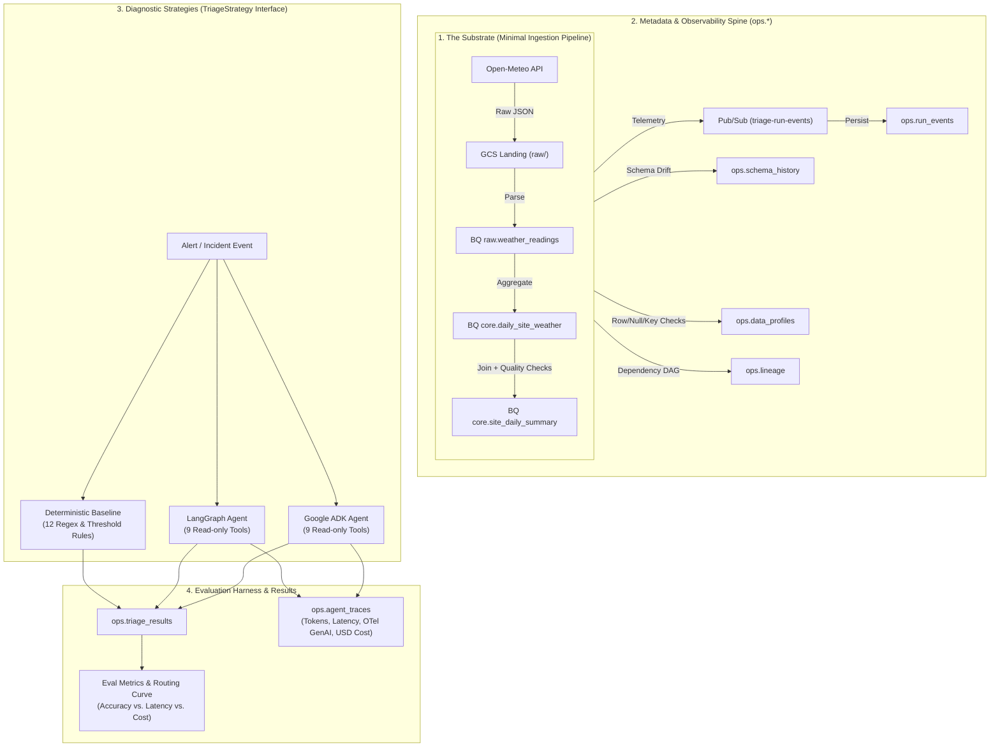

# Agentic Incident Triage for Data Pipelines

[](https://www.python.org/downloads/)
[](#)
[](#)
[](#)
[](LICENSE)

An autonomous incident investigation agent that diagnoses data-pipeline failures using run metadata, schema history, data profiles, and lineage. The agent returns a ranked root cause with verifiable evidence and proposed remediation behind a human-in-the-loop approval gate.

Evaluated against **20 injected fault modes** (silent data corruption vs. loud crashes) and benchmarked on **accuracy, latency, and cost** against a 12-rule deterministic baseline with tiered model routing.

---

## 📌 The Problem

In modern data platforms, pipeline failures are expensive—not because fixing them takes long, but because **diagnosing them takes 20+ minutes of manual detective work**:
1. An alert fires (`Pipeline B failed` or silent bad data arrives downstream).
2. An engineer manually checks Cloud Logging for stack traces.
3. If no stack trace exists, they inspect row counts, schema history, and null rates across partitions.
4. They manually trace lineage upstream to determine if the issue originated in Pipeline A, external source drift, or an infrastructure permission blip.

**This project automates that 20-minute investigation into a 15-second agentic workflow.**

---

## 🏛 Architecture



---

## 🎯 Key Architectural Principles

1. **Strict Typed Boundaries (Zero Hallucination Leaks):**
   Every boundary (tool inputs, tool outputs, `Incident`, `TriageResult`) is enforced with strict Pydantic models (`extra="forbid"`). Tools are strictly read-only and return structured evidence.
2. **Strategy Pattern (`TriageStrategy` Protocol):**
   The eval harness is agnostic to the engine. The rule baseline, LangGraph, and Google ADK all conform to:
   ```python
   class TriageStrategy(Protocol):
       name: str
       routing_policy: str  # all_cheap | all_premium | tiered
       def diagnose(self, incident: Incident) -> TriageResult: ...
   ```
3. **Loud vs. Silent Failure Evaluation:**
   Evaluated against 20 injected faults. While deterministic rules catch loud crashes (e.g., OOM, 403, syntax errors), the agent proves its value on **silent faults** (schema additions, timezone shifts, unit conversions °C $\rightarrow$ °F, sentinel values, duplicate keys).
4. **Cost-Aware Model Routing:**
   Every reasoning step is traced using OpenTelemetry GenAI semantics into `ops.agent_traces`. We benchmark **tiered routing** (cheap Flash model for evidence gathering + Pro model for reasoning) against all-Flash and all-Pro baselines.

---

## 📂 Repository Structure

```text
incident-triage-agent/
├── config/                 # Site coordinates and Vertex AI pricing configurations
├── infra/                  # Terraform IaC (GCP Datasets, IAM, Buckets, Budgets)
├── substrate/              # The data pipeline that breaks (ingestion, gold, checks)
│   ├── pipelines/          # ingest_weather.py, build_gold.py
│   ├── checks/             # data_quality.py (assertions & triggers)
│   └── workflows/          # Cloud Workflows & Scheduler orchestration
├── ops/                    # Telemetry & Metadata Spine
│   ├── schemas/            # BigQuery DDL for ops.* tables
│   ├── emitters/           # Telemetry emitters for run events and profiles
│   └── setup_tables.py     # Idempotent BigQuery table provisioner
├── triage/                 # Diagnostic Core
│   ├── contracts.py        # Single source of truth Pydantic models
│   ├── strategy.py         # TriageStrategy Protocol
│   ├── tools/              # 9 read-only diagnostic tools
│   ├── baseline/           # 12-rule deterministic engine
│   ├── agents/             # langgraph/ and adk/ implementations
│   └── tracing/            # OTel GenAI attributes & cost calculator
├── eval/                   # Benchmark & Fault Injection Harness
│   ├── faults/             # 20 composable setup/teardown fault injectors
│   ├── runner.py           # Repeatable eval execution engine (3x runs)
│   └── metrics.sql         # SQL aggregation queries for accuracy & cost curves
├── tests/                  # Unit and contract verification tests
└── docs/                   # Architectural decisions, specs, and weekly build logs
```

---

## 📅 Phased Build Roadmap

| Phase | Timeline | Focus | Deliverables | Status |
|:---:|:---:|:---|:---|:---:|
| **Week 1** | Oct 18 – Oct 24 | **Substrate & Contracts** | GCP Terraform foundation, Pydantic contracts, Open-Meteo pipelines, 60-day backfill, Cloud Run & Scheduler | 🟢 Completed |
| **Week 2** | Oct 25 – Oct 31 | **Metadata & Baseline** | 4 `ops.*` tables, 9 diagnostic tools with unit tests, 12-rule baseline | ⚪ Pending |
| **Week 3** | Nov 01 – Nov 07 | **LangGraph Agent** | Graph orchestration, bounded tool loops, GenAI OTel trace capture | ⚪ Pending |
| **Week 4** | Nov 08 – Nov 14 | **Faults & Evaluation** | 20 composable fault injectors, eval runner (3 repeats), baseline vs. agent report | ⚪ Pending |
| **Week 5** | Nov 15 – Nov 21 | **Cost Routing & Ship** | Tiered routing experiment (Flash vs. Pro), latency/cost curves, Cloud Run deploy | ⚪ Pending |
| **Week 6** | Nov 22 – Nov 29 | **Google ADK & Comparison** | Google ADK implementation of `TriageStrategy`, dual-framework benchmark | ⚪ Pending |

---

## 🚀 Getting Started

### Prerequisites
- Python 3.11+
- [`uv`](https://github.com/astral-sh/uv) (fast Python package manager)
- Google Cloud SDK (`gcloud`) & [Terraform](https://www.terraform.io/) `>= 1.6`

### Setup

1. **Clone the repository:**
   ```bash
   git clone https://github.com/dev-abhishekv/incident-triage-agent.git
   cd incident-triage-agent
   ```

2. **Initialize Python virtual environment with `uv`:**
   ```bash
   uv venv
   source .venv/bin/activate  # On Windows: .venv\Scripts\activate
   uv pip install -e ".[dev,agents]"
   ```

3. **Configure Environment:**
   ```bash
   cp .env.example .env
   # Populate GCP_PROJECT, GCP_REGION, and bucket names
   ```

4. **Run Contract Tests:**
   ```bash
   pytest tests/
   ```

---

## 📊 Evaluation & Verification Metrics

- **Top-1 Root Cause Accuracy:** Exact match against ground-truth injected `root_cause_id`.
- **Accuracy by Signal Class:** Loud crashes vs. Silent semantic anomalies.
- **False-Confidence Rate:** Incorrect diagnosis with confidence score $> 0.7$.
- **Cost per Triage Incident:** Micro-dollar token calculation from `ops.agent_traces`.
- **Latency Distribution:** $p50$ and $p95$ turnaround time per incident.

---

## 📜 License

This project is licensed under the MIT License - see the [LICENSE](LICENSE) file for details.
